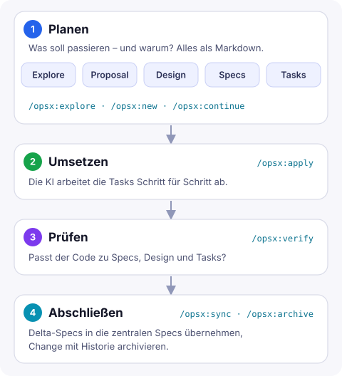

KI-Assistenten schreiben Code schneller, als man ihn lesen kann. Das eigentliche Problem ist ein anderes: *Was* gebaut werden soll und *warum*, steht meistens nur im Chatverlauf. Ist die Sitzung vorbei, ist das Wissen weg. Die nächste Änderung beginnt wieder bei null, und nach ein paar Wochen weiß niemand mehr, welche Anforderung eigentlich gilt.

Spec-Driven Development dreht die Reihenfolge um: Zuerst wird die Spezifikation geschrieben, dann der Code. Wir nutzen dafür auf der Arbeit [OpenSpec](https://github.com/Fission-AI/OpenSpec) – inzwischen in allen Bereichen und für fast jede Aufgabe.

## Was OpenSpec ist

OpenSpec ist ein leichtgewichtiges Framework, das ausschließlich mit Markdown-Dateien im Repo arbeitet. Es gibt zwei zentrale Ordner:

```text
openspec/
├── specs/                  # was heute gilt – die aktuellen Anforderungen
│   ├── suche/spec.md
│   └── …
└── changes/                # was sich gerade ändert
    ├── suche-filter/
    │   ├── proposal.md
    │   ├── design.md
    │   ├── tasks.md
    │   └── specs/suche/spec.md   # Delta-Spec
    └── archive/
        └── 2026-11-09-suche/     # abgeschlossene Changes mit Historie
```

`specs/` beschreibt den aktuellen Stand des Systems. Jede Änderung bekommt unter `changes/` einen eigenen Ordner mit allem, was dazugehört. Die Änderungen an den Anforderungen stehen dort als **Delta-Specs** – also nur das, was hinzukommt, sich ändert oder wegfällt. Erst wenn der Change fertig ist, wandern sie in die zentralen Specs.

## Warum OpenSpec: Living Specs

Genau das war für uns der wichtigste Grund, uns für OpenSpec zu entscheiden: Die Specs sind **Living Specs**. Sie beschreiben nicht, was irgendwann einmal geplant war, sondern immer den aktuellen Stand des Systems.

Bei vielen Ansätzen entsteht pro Feature ein Dokument, das nach der Umsetzung niemand mehr anfasst. Nach ein paar Monaten widersprechen sich die Dokumente, und die Wahrheit steht wieder nur im Code. Bei OpenSpec fließt jede abgeschlossene Änderung über die Delta-Specs zurück in `specs/`. Wer wissen will, *wie* sich etwas verhalten soll, schaut dort nach. Wer wissen will, *warum*, findet den Change im Archiv.

OpenSpec ist an kein Werkzeug gebunden. Es bringt Befehle für Claude Code, GitHub Copilot und andere Assistenten mit, die Dateien selbst sind einfach Markdown.

## Der Ablauf



**1. Planen.** Mit `/opsx:explore` untersucht die KI zusammen mit mir das Problem und bewertet Optionen – noch ohne eine Zeile Code. `/opsx:new` legt den Change an, `/opsx:continue` erstellt Schritt für Schritt die Artefakte:

- `proposal.md`: Ziel, Motivation und Umfang
- `design.md`: technischer Ansatz und Architektur
- Delta-Specs: die neuen oder geänderten Anforderungen
- `tasks.md`: die Umsetzung als Checkliste

Jedes Artefakt lese ich, bevor das nächste entsteht. Hier fallen die meisten Missverständnisse auf – und zwar bevor sie Code geworden sind.

**2. Umsetzen.** `/opsx:apply` arbeitet die Tasks ab und hakt sie in `tasks.md` ab. Weil Proposal, Design und Specs im Repo liegen, hat die KI den vollen Kontext, auch in einer neuen Sitzung.

**3. Prüfen.** `/opsx:verify` gleicht die Umsetzung mit den Artefakten ab: Sind alle Anforderungen erfüllt, passt der Code zum Design, sind alle Tasks erledigt?

**4. Abschließen.** `/opsx:sync` übernimmt die Delta-Specs in die zentralen Specs, `/opsx:archive` verschiebt den Change mit Datum ins Archiv. Die Historie bleibt erhalten: Auch in einem Jahr ist nachvollziehbar, warum eine Anforderung so ist, wie sie ist.

## Wie eine Delta-Spec aussieht

Anforderungen werden in einem festen Format beschrieben, mit Szenarien, die sich direkt in Tests übersetzen lassen. Ein Beispiel, passend zur Suche auf dieser Seite:

```markdown
## ADDED Requirements

### Requirement: Suchbegriff in der URL
Die Suchseite SHALL den aktuellen Suchbegriff als Parameter `q` in der URL führen.

#### Scenario: Link mit Suchbegriff öffnen
- **WHEN** jemand `/suche/?q=dependabot` aufruft
- **THEN** steht „dependabot“ im Suchfeld
- **AND** die Treffer werden sofort angezeigt
```

Das ist für Menschen lesbar, für die KI eindeutig und im Pull Request gut zu prüfen.

## Unsere Erfahrungen

**Greenfield und Brownfield.** Wir haben OpenSpec erfolgreich in neuen Projekten eingesetzt und ebenso in bestehenden, über Jahre gewachsenen Codebasen. Bei neuen Projekten wachsen die Specs von Anfang an mit dem Code. Bei bestehenden muss niemand erst das ganze System nachdokumentieren: Die Specs entstehen Change für Change genau dort, wo gerade gearbeitet wird. So wächst die Dokumentation mit, statt ein eigenes Projekt zu werden.

**Bei den Standardsprachen lief es fast von selbst.** In Projekten mit C#, Python oder PowerShell ließ sich jeder Schritt direkt abbilden. Bauen, testen und prüfen gehen mit den üblichen Werkzeugen wie `dotnet test`, `pytest` oder Pester, und die KI kennt sie. Der Ablauf funktionierte vom ersten Tag an.

**Im ERP-Umfeld mit Business Central war mehr Vorarbeit nötig.** Dort sind Dinge wie das Bauen der App-Datei oder das Ausführen der automatisierten Tests nicht mit einem Standardbefehl erledigt. Wir mussten diese Prozesse der KI erst beibringen: mit Skills und Skripten, die genau beschreiben, wie die App gebaut und wie die Tests ausgeführt werden. Erst dann geht die KI bei jeder Umsetzung denselben Weg – und `/opsx:apply` und `/opsx:verify` liefern verlässliche Ergebnisse.

Die Lehre daraus: Spec-Driven Development ist nur so gut wie die Werkzeuge, mit denen die KI ihre Arbeit prüfen kann. Wo Bauen und Testen nicht selbstverständlich sind, lohnt sich die Investition in Skills und Skripte doppelt.

**Nicht für jede Kleinigkeit.** Wenn ich genau weiß, welche Zeile sich ändern muss, bin ich selbst schneller als jeder Ablauf mit Proposal und Tasks. Für alles andere – neue Funktionen, Umbauten, Fehler mit unklarer Ursache – nutzen wir OpenSpec inzwischen fast immer.

## Mein Fazit

Mit KI wird Code billig. Teuer bleibt, das Richtige zu bauen und später noch zu wissen, warum. OpenSpec löst genau das: Die Absicht steht im Repo, nicht im Chat – und dank Living Specs ist sie immer auf dem aktuellen Stand. Ein paar Minuten für Proposal und Specs sparen mir regelmäßig Stunden an Nacharbeit – und machen die Ergebnisse der KI planbar.
